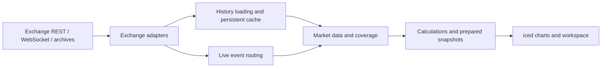

<div align="center">

# Flowdepth

### A native crypto order-flow research terminal

Footprint charts · Spot/perpetual comparison · Volume profiles · VWAP · CVD · Open interest

[](LICENSE)
[](rust-toolchain.toml)
[](https://github.com/iced-rs/iced)
[](#project-status)

[Getting started](#getting-started) · [Features](#features) · [Architecture](#architecture) · [Review guide](REVIEW.md) · [Roadmap](#roadmap)

</div>

Flowdepth is a Rust desktop terminal for studying crypto market structure and order flow: move from higher-timeframe context to spot/perpetual positioning, then inspect individual executions on a footprint chart.

This repository is an actively developed fork of [Niketion/flowdepth](https://github.com/Niketion/flowdepth), originally derived from [Flowsurface](https://github.com/flowsurface-rs/flowsurface). It preserves the shared history, original license and contributor attribution. The current work focuses on trustworthy market data, reusable calculations and a flexible trading workspace.

> **Working branch:** `feat/delta-table`. This is experimental research software, not a finished release. Features inherited from upstream are not automatically validated by this fork. No fork-specific binary releases are currently published.

## Features

### Footprint and execution analysis

- **Table and Delta Table** views with side dominance, highlighted point of control and imbalance markings.
- **Automatic row sizing** to keep footprint rows readable as the chart scale changes.
- **Bar statistics** for buy/sell volume, delta, delta percentage and trade activity.
- **Order-flow studies:** absorption, trapped traders, exhaustion, stacked imbalances, unfinished and failed auctions.
- **Volume bubbles**, Time & Sales, liquidation feeds, depth heatmaps and a DOM/ladder as complementary market views.

Order-flow detections are research heuristics. Their presence is not evidence of predictive performance; some historical signals depend on later confirmation.

### Positioning and market comparison

| Tool | Purpose |
|---|---|
| Futures + Spot CVD | Compare aggressive flow across both Binance markets, with optional per-bar delta columns |
| CVD by order size | Inspect flow grouped by estimated order-size buckets |
| Open Interest | View historical positioning with paginated loading and explicit cache coverage |
| Spot/perpetual workspace | Compare the same symbol with synchronized time navigation and independent price scales |

Order-size grouping is inferred from public executions, not participant identity. Historical aggregates have less execution detail than raw trades.

### Profiles and reference levels

- **Session Volume Profile** and **Fixed Range Volume Profile** with POC, VAH and VAL.
- **Previous-period highs/lows:** PDH/PDL, PWH/PWL and PMH/PML, using UTC boundaries.
- **Naked levels** from completed sessions, with checks for subsequent price touches.
- **Session, weekly and monthly VWAP**, including optional deviation bands.
- Shared fixed-range reference levels across charts of the same symbol.

Data quality is part of the calculation. Incomplete fixed-range and naked levels are withheld from the relevant shared-level and signal paths. Candle-based profile approximations are marked with `~`; coverage details appear in the chart header.

Weekly/monthly VWAP uses hourly typical prices `(H+L+C)/3` and candle volume. It is an approximation, not an exact trade-by-trade VWAP.

### Workspace and data handling

- Multiple layouts, chart panes and pop-out windows.
- Live subscriptions shared across layouts, including inactive tabs.
- Persistent market-data storage with unit-aware quantity keys and gap recovery.
- Safe state-file replacement, recovery copies and per-profile instance locking.
- Isolated test profiles for checking changes without replacing working layouts.
- Shared pending candle requests and reuse of newly cached trade history between overlapping loaders.

## Project status

The terminal is being developed and exercised primarily on **Windows with Binance BTCUSDT spot and perpetual data**. Other inherited adapters and platform paths remain in the source tree; they do not have the same level of verification in this fork.

The latest recorded profile-core validation completed **548 tests with 0 failures**, with 15 tests ignored. All-target compilation and formatting checks also passed. This is a recorded local validation result, not a claim that every feature or platform has been certified. See [current engineering state](docs/state.md) and the [profile-core report](docs/profile-core-batch.md).

A current screenshot of this fork has not been published yet. Upstream screenshots are deliberately omitted so they cannot be mistaken for the tested workspace.

## Getting started

### Requirements

- Git and [Rust installed through rustup](https://www.rust-lang.org/tools/install).
- The toolchain pinned in [`rust-toolchain.toml`](rust-toolchain.toml).
- A graphics environment supported by iced/wgpu.
- Access to the public market-data endpoints used by your chosen exchange.

| Platform | Setup notes |
|---|---|
| Windows | Rust MSVC toolchain and Visual Studio C++ Build Tools; primary validation platform |
| Linux | Native development dependencies; inherited build path, not recently validated in this fork |
| macOS | Xcode Command Line Tools; inherited build path, not recently validated in this fork |

Typical Debian/Ubuntu dependencies:

```sh
sudo apt install build-essential pkg-config libasound2-dev
```

### Build and run

```sh
git clone --branch feat/delta-table https://github.com/Mixannik/flowdepth.git
cd flowdepth
cargo build --release --locked
cargo run --release --locked
```

The executable is named `flowsurface` (`flowsurface.exe` on Windows) for compatibility with the existing codebase. Build output is under `target/release/`.

### Use an isolated profile

```sh
cargo run --release --locked -- --profile-dir ./.local/test-profile
```

Each profile has separate application state, cache and logs. Use a directory outside the repository or keep it untracked. See [profile isolation and limitations](docs/profiles.md), including the shared OS credential store. Local layouts and market data are not bundled with this repository.

For the repository's prepared test-profile workflow, Node.js is additionally required:

```sh
node scripts/test-profile.mjs
```

## Architecture



| Area | Responsibility |
|---|---|
| `exchange/` | Exchange adapters, market types, price/quantity units and source contexts |
| `src/connector/` | Historical requests, retries, cache validation and backfill |
| `data/src/analysis/` | Extracted period-level, HTF VWAP, value-area and naked-level calculations |
| `src/chart/kline/profile_state.rs` | Prepared profile snapshots, independent cache keys and publication gates |
| `src/chart/` | Chart adapters, studies, rendering and interactions |
| `src/screen/` | Layouts, panes and workspace controls |
| `indicator-engine/` | Inherited indicator-language compiler and runtime |

The extraction is incremental. Some calculations and orchestration still live in large chart modules. Moving code between files alone is not considered completion: calculations need explicit inputs, coverage semantics and regression checks.

## Development and verification

Run checks from the workspace root:

```sh
cargo fmt --all -- --check
cargo check --workspace --all-targets --locked
cargo test --release --workspace --locked
```

Some ignored tests require GPU rendering or a separate stress run. Workspace-wide checks are preferred: standalone package builds can expose existing dependency-feature unification issues. A strict Clippy run has known outstanding findings; a green test run does not imply a clean strict lint run.

For external reviews, start with [REVIEW.md](REVIEW.md). Priorities include:

- Consistent volume/delta across live, history, compaction and cache replay.
- Correct units for spot, linear and inverse markets.
- Coverage checks before treating a level as confirmed.
- Cancellation, stale results and source-generation boundaries.
- Safe persistence and independent calculation/view lifecycles.

## Known limitations

- Binance OI history is limited to roughly the most recent month through its public API; previously cached samples may remain available locally.
- Exchange-side gaps, unavailable archives and access restrictions cannot be repaired by inventing data.
- Compacted trade history loses execution ordering and price detail; candle-derived profiles are approximations.
- Canonical storage independent of BTC/USD display preferences and complete replay equivalence are still ongoing work.
- A full source session and subsequent price path are needed to establish an untested naked level.
- This fork's layouts, themes and account-specific configuration are not included. Never attach credentials or unredacted saved state to an issue.

## Roadmap

1. Finish data provenance, quantity and coverage contracts across remaining calculations.
2. Expand replay checks for live/history/cache/compaction equivalence.
3. Consolidate data requirements, request ownership and cancellation.
4. Improve pane management, indicator configuration and workspace recovery.
5. Extend order-flow tools after the underlying data and calculation paths are reliable.

See the [core architecture plan](docs/core-architecture.md), [workspace direction](docs/terminal-workspace.md) and [order-flow roadmap](docs/orderflow-roadmap.md). Detailed engineering notes are currently maintained primarily in Russian; this README and the review entry point are in English.

## Contributing and feedback

Bug reports and code reviews are welcome through [Issues](https://github.com/Mixannik/flowdepth/issues) and [Pull Requests](https://github.com/Mixannik/flowdepth/pulls).

For a data discrepancy, include the market, symbol, timeframe, **UTC timestamp**, quantity units and a redacted reproduction. For a calculation change, include a small input fixture and expected results. Clearly separate observed behavior from assumptions about the exchange or signal.

See [CONTRIBUTING.md](CONTRIBUTING.md) and [SECURITY.md](SECURITY.md).

## Lineage and license

This fork builds on [Niketion/flowdepth](https://github.com/Niketion/flowdepth) and its [Flowsurface](https://github.com/flowsurface-rs/flowsurface) foundation. Original authorship and Git history are retained. It is independently maintained and is not an official release of either upstream project.

Distributed under the **GNU General Public License v3.0 or later**. See [LICENSE](LICENSE).
